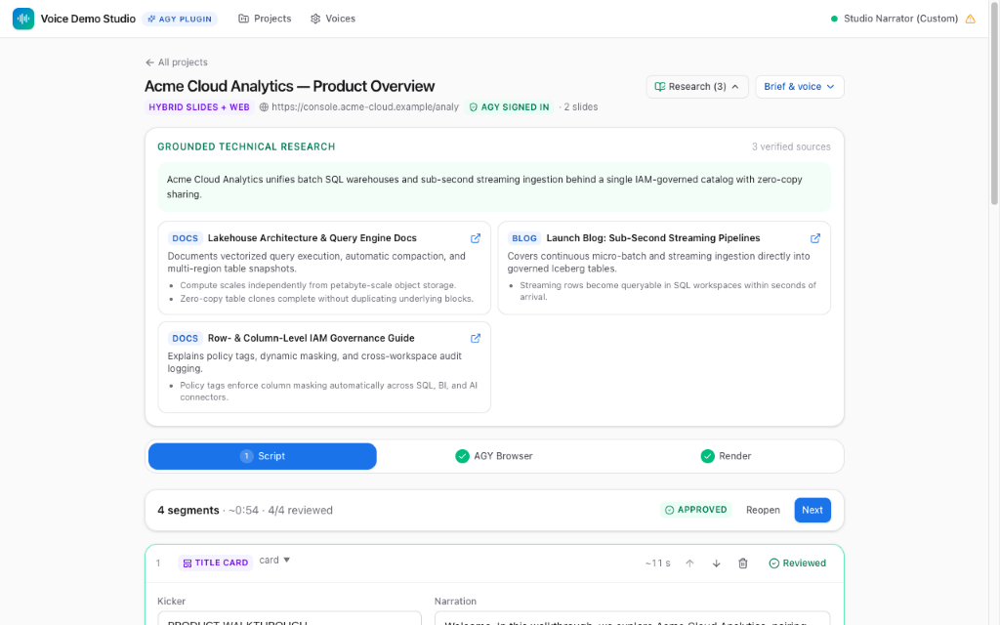
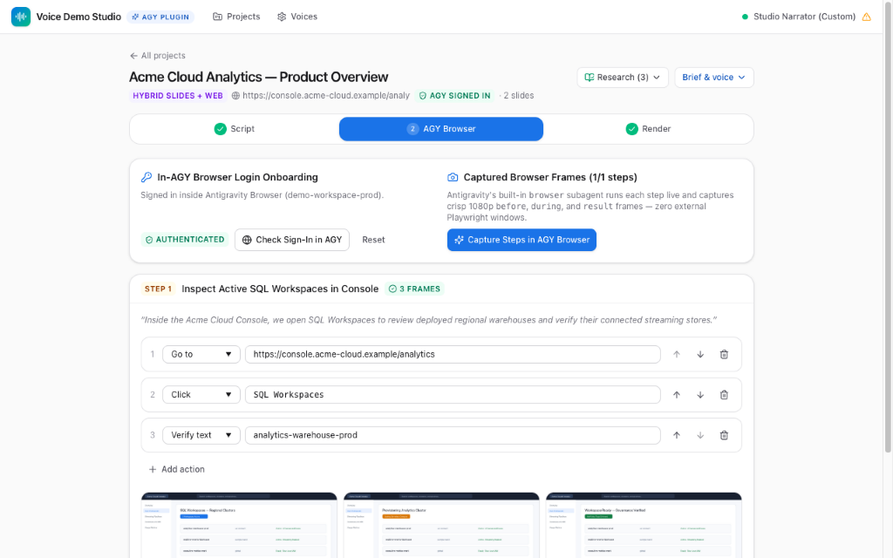
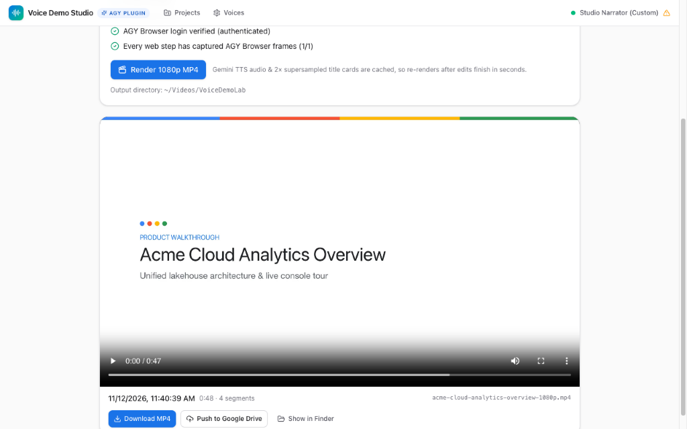
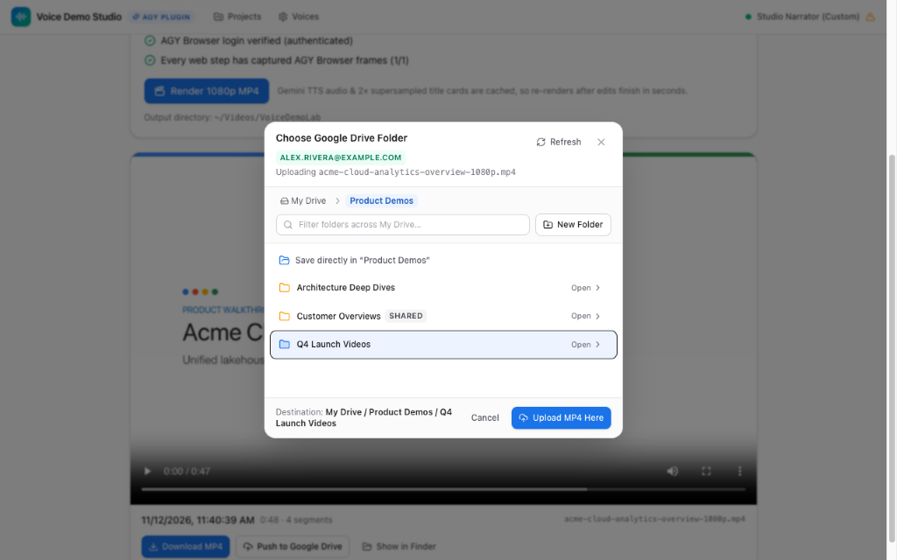

# Voice Demo Lab

Automate research-grounded, **1080p (`1920×1080`) and 4K (`3840×2160`)** narrated demo and overview videos from **slides** or **live websites** — orchestrated end-to-end as a plugin inside **Google Antigravity** (primary) and compatible with **Claude Code**, voiced in **your custom Gemini TTS voice** or any standard Gemini voice.

> **Plugin-Only Architecture (`v0.7.0`)**: Voice Demo Lab runs strictly as an AI coding-environment plugin (MCP server + Antigravity Sidecar Studio panel + research subagent + skill) — with zero standalone CLI commands and zero external Playwright browser windows.

---

## Supported Demo Scenarios

1. **Slides Created in Antigravity + Session Context + Instructions**
   Build a Google Slides deck (or PDF/PPTX) during your Antigravity session, then ask Antigravity to turn it into a narrated video. `.pptx` and `.pdf` decks render natively in pure Python with zero LibreOffice or Keynote dependency at either **`1080p` (`1920×1080`)** or **`4K` (`3840×2160`)**, combining your slides, speaker notes, session context, and verified technical research into a cohesive script.
2. **User-Provided Slides + Context + Directions**
   Point Antigravity at an existing Google Slides URL/ID, `.pdf`, or `.pptx` deck along with your audience, tone, target runtime, and focus areas — rendered natively in pure Python with zero external office suite required at **`1080p`** or **`4K`**.
3. **Live Website Walkthroughs in Antigravity's Built-In Browser**
   Give Antigravity any live web app or cloud console URL (for example `https://console.cloud.google.com` or `http://localhost:3000`). Antigravity runs an **interactive login onboarding check** inside your Antigravity Browser pane first (pausing so you can sign in if needed), explores the live UI, captures crisp **1080p and HiDPI 4K-ready** `before` / `during` / `result` frames with spotlight callouts and smooth zooms, and renders the narrated video.
4. **Hybrid (Slides + Live Website)**
   Blend supersampled title cards, architecture slides, and live browser walkthrough steps into a single **1080p or 4K MP4**.

---

## Voice Demo Studio (Side Panel Walkthrough)

Voice Demo Studio opens directly in Google Antigravity's auxiliary side pane (`[Voice Demo Studio](sidecar://custom-voice-demo-lab/studio/)`) right beside your chat.

### 1. Reality-Grounded Script Editor & Voice Preview
Before drafting narration, `demo-researcher` verifies slide claims, product capabilities, recent launch blogs, release notes, and documentation — attaching verified citations right above and beside your script segments. Edit any line inline, adjust pacing (`0.70×`–`1.40×` with pitch preserved), preview individual segments in your voice, and approve when ready.



### 2. 100% In-Antigravity Browser Onboarding & Frame Capture
Website and hybrid demos run exclusively inside Antigravity's built-in browser. Studio tracks sign-in onboarding status and previews captured `before`, `during`, and `result` **1080p and HiDPI 4K-ready** frames, action choreography, spotlight highlights, and fast-forward wait banners.



### 3. 1080p & 4K MP4 Rendering + Local Save-As Download
Choose **`1080p · Full HD (1920×1080)`** or **`4K · Ultra HD (3840×2160)`** globally in **Settings → Output**, per project, or right on the **Render** tab:
- 4K renders natively re-rasterize vector `.pptx` and `.pdf` slides at `3840×2160`, supersample title/recap cards (`5760×3240` downsampled to `3840×2160`), preserve HiDPI browser captures, proportionally scale spotlight callouts and fast-forward banners, and display resolution badges (`1080p · 1920×1080` / `4K · 3840×2160`) on render cards.
- Gemini TTS audio clips are cached by text and voice, so generating both a `1080p` and a `4K` MP4 from the same script takes seconds.
- Clicking **Download MP4** opens a native OS **Save As** file picker so you can choose the exact destination folder and filename on your machine.



### 4. Graphical Google Drive Export (`gdrive` Integration)
Export rendered MP4s straight to Google Drive through Antigravity's official **Google Drive (`gdrive`)** plugin:
- If `gdrive` is not yet installed, disabled, or signed out in Antigravity, **Push to Google Drive** stays greyed out with an adjacent **Install Google Drive** / **Sign in to Google Drive** button right next to it to initiate setup in one click.
- Once connected, clicking **Push to Google Drive** opens a graphical folder browser with `My Drive › …` breadcrumbs, nested subfolder drill-down, search filtering, and inline **+ New Folder** creation, then adds an **Open in Google Drive** link directly on the render card.



### 5. Self-Contained Pure-Python PPTX & Vector Slide Engine
Voice Demo Lab includes a built-in `.pptx` renderer ([`demolab/pptx_render.py`](demolab/pptx_render.py) powered by `python-pptx`, `resvg-py`, `img2pdf`, and `pypdfium2`) that converts PowerPoint decks directly into crisp `1920×1080` (`1080p`) or `3840×2160` (`4K`) PNGs and PDFs without LibreOffice or Keynote:
- Parses DrawingML themes, slide masters/layouts, linear gradients, rounded & vector geometry, `a:tblGrid`-accurate tables, grouped shapes, charts, SmartArt text/diagram fallbacks, and embedded images.
- Teams that explicitly prefer external conversion via LibreOffice or macOS Keynote can opt in with `DEMOLAB_PPTX_BACKEND=external`.

---

## Requirements

- macOS or Linux with [uv](https://docs.astral.sh/uv/) and `ffmpeg`:
  ```bash
  brew install uv ffmpeg
  ```
- A Gemini API key from [Google AI Studio](https://aistudio.google.com/apikey) (to use a custom voice, create the key in the same AI Studio project that owns the voice).
- Optional:
  - **Google Slides / Google Drive plugins** in Antigravity (`gslides` for native Google Slides export; `gdrive` for graphical Drive uploads).
  - PowerPoint (`.pptx`), `.pdf`, and exported Google Slides decks all render natively at `1920×1080` (`1080p`) or `3840×2160` (`4K`) in pure Python (`demolab/pptx_render.py` + `resvg-py` + `pypdfium2`) with no LibreOffice or Keynote required.

---

## Install

### Google Antigravity (Recommended)

```bash
agy plugin install https://github.com/mlaslie/custom-voice-demo-lab
```

Start a new Antigravity conversation after installing. To upgrade later:

```bash
agy plugin uninstall custom-voice-demo-lab
agy plugin install https://github.com/mlaslie/custom-voice-demo-lab
```

### Claude Code

In a Claude Code session (terminal or Claude desktop **Code** tab):

```text
/plugin marketplace add mlaslie/custom-voice-demo-lab
/plugin install custom-voice-demo-lab@voice-demo-lab
```

Or from a terminal:

```bash
claude plugin marketplace add mlaslie/custom-voice-demo-lab
claude plugin install custom-voice-demo-lab@voice-demo-lab
```

---

## First-Time Voice Setup

On first use, Antigravity surfaces the **Voice Demo Studio** pill in chat with a 4-tab layout (**Projects**, **Voice Lab**, **Auth**, and **Settings**):

1. **Add your Gemini API key** on the **Auth** tab — saved directly to your OS keychain (`keyring`), verifiable in place, and never passed through chat or MCP tool arguments.
2. **Select or record a voice** on the **Voice Lab** tab — choose from over 2,100 standard Gemini voices across 39 locales, pick an existing custom voice, or create a new custom voice right inside Studio using the local-system recording device selector, the live circular HAL 9000 voice meter, a 20s+ reference calibration sample, and the spoken consent statement.
3. **Configure defaults** on the **Settings** tab — set your default narrator voice, delivery style, pace, output folder, resolution (`1080p` or `4K`), target audience, and Gemini TTS model.

---

## Example Prompts

- *"Create a 2-minute narrated demo video from the architecture slides we just created in this session."*
- *"Turn `https://docs.google.com/presentation/d/...` into an executive overview video grounded in the latest product documentation."*
- *"Create a short walkthrough demo video for `https://console.cloud.google.com` showing how to inspect deployed enterprise AI applications using the Antigravity browser."*
- *"Combine our intro slides with a live walkthrough of `http://localhost:3000` in my custom narrator voice, paced 5% faster."*
- *"Render both a 1080p and a 4K executive overview video from ./overview.pptx comparing model performance, speed, and cost per task."*

---

## Privacy & Security

- **100% Local Execution**: Runs locally on `127.0.0.1` protected by DNS-rebinding, `Origin`, and Antigravity `X-Sidecar-Token` verification.
- **Keychain-Only API Keys**: Gemini API keys are stored exclusively in your OS keychain (`demolab` service); tools and UI responses expose only the key label and last four characters.
- **In-Browser Authentication**: Live website sessions stay inside your own Antigravity Browser pane — credentials and cookies are never read or stored by Voice Demo Lab.

---

## Development

See [docs/development.md](docs/development.md) for the plugin directory layout, sidecar architecture, and running the automated `pytest` suite.

Voice Demo Lab is an independent project. It is not made or endorsed by Google or Anthropic.
